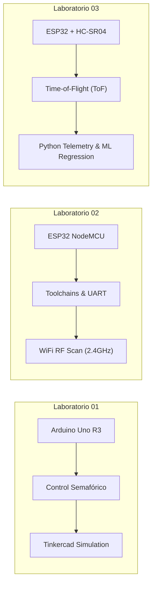
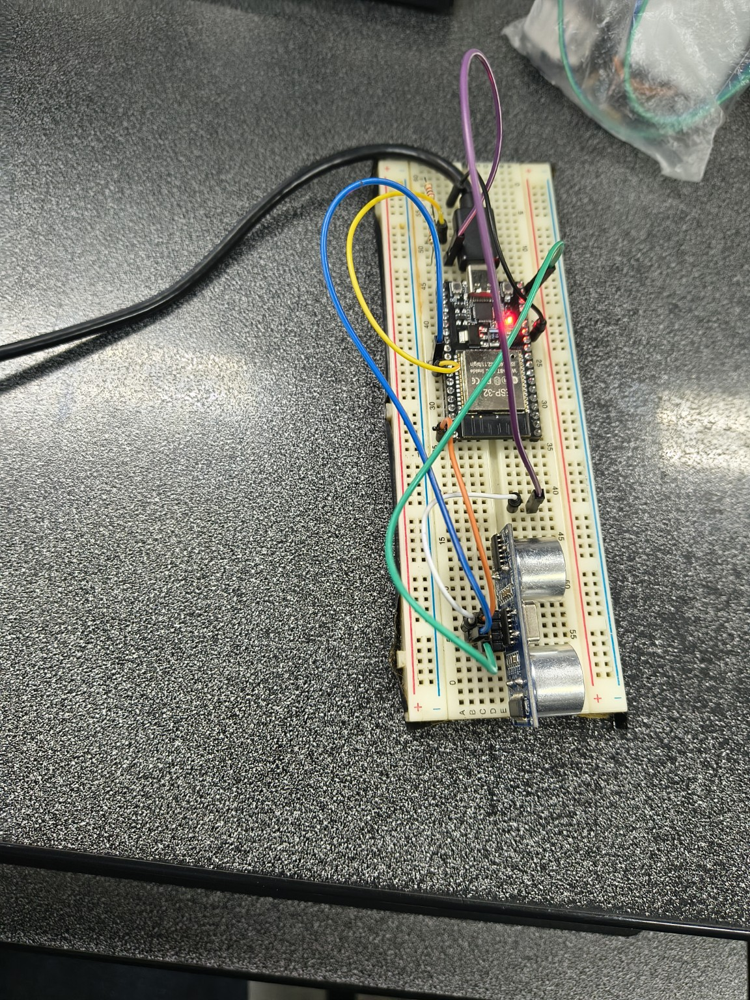

# Prácticas de Laboratorio de Robótica - UNSAAC

<div align="center">


### UNIVERSIDAD NACIONAL DE SAN ANTONIO ABAD DEL CUSCO
**Facultad de Ingeniería Eléctrica, Electrónica, Informática y Mecánica**  
**Escuela Profesional de Ingeniería Informática y de Sistemas**  

[](https://unsaac.edu.pe)
[](https://unsaac.edu.pe)
[](https://www.arduino.cc/)
[](https://www.python.org/)
[](LICENSE)

</div>

---

## 👨‍💻 Información Académica

* **Asignatura:** Robótica
* **Docente Titular:** Ing. Jose Mauro Pillco Quispe
* **Estudiante:** Noe Franklin Choquenaira Quispe
* **Código Universitario:** 133962
* **Correo Institucional:** [133962@unsaac.edu.pe](mailto:133962@unsaac.edu.pe)
* **Repositorio Oficial:** [LAB-ROBOTICA-unsaac](https://github.com/frankich99/LAB-ROBOTICA-unsaac)
* **Cusco – Perú, 2026**

---

## 📑 Resumen General de los Laboratorios

Este repositorio centraliza de forma modular, estructurada y profesional el código fuente, la documentación técnica ("floro" académico riguroso, teoría física y esquemas de conexión) y las pruebas experimentales desarrolladas a lo largo de las guías de laboratorio de la asignatura de **Robótica**:

| Laboratorio | Título / Tema Principal | Plataforma Hardware | Lenguajes y Entornos | Enlace Directo |
| :---: | :--- | :---: | :---: | :---: |
| **Lab 01** | Análisis, Diseño y Simulación de Circuitos de Control Semafórico | Arduino Uno R3 | C++ / Arduino, Autodesk Tinkercad | [Ver Lab 01](labo_01/) |
| **Lab 02** | Puesta en Marcha, Configuración del Toolchain y Validación del ESP32 NodeMCU | ESP32 NodeMCU V1 (30 pines) | C++ / Arduino IDE 2.3.10, Espressif v3.3.12 | [Ver Lab 02](labo_02/) |
| **Lab 03** | Medición de Distancia por Ultrasonido (HC-SR04), ToF y Calibración Metrológica | ESP32 DevKit + HC-SR04 | C++ OOP, Python 3 (Matplotlib, PySerial) | [Ver Lab 03](labo_03/) |

---

## 📂 Arquitectura Global del Repositorio

```text
LAB-ROBOTICA-unsaac/
├── .gitignore                          # Exclusiones estándar globales de Git
├── LICENSE                             # Licencia libre MIT
├── README.md                           # Documentación principal del repositorio de Robótica
│
├── labo_01/                            # LABORATORIO 01: ARDUINO UNO & SIMULACIÓN
│   ├── README.md                       # Informe técnico y diagramas de estados semafóricos
│   ├── 1_prender_y_apagar_un_led1.ino  # Circuito 1: Parpadeo de LED básico
│   ├── 2_simular_el_funcionamiento_de_un_sem_foro_americano1.ino
│   ├── 3_simular_de_sem_foro_para_carros_y_personas1.ino
│   └── 4_simular_el_funcionamiento_con_bot_n_peatonal_1.ino
│
├── labo_02/                            # LABORATORIO 02: PUESTA EN MARCHA ESP32 NODEMCU
│   ├── README.md                       # Documentación de instalación, toolchains y pruebas
│   ├── Informe de Laboratorio - Configuración y Pruebas ESP32 (1).pdf
│   ├── assets/images/                  # Capturas de pantalla, gestor de placas y flasheo
│   └── firmware/
│       ├── prueba1_blink_led/          # Control digital de GPIO 2 (LED azul integrado)
│       │   └── prueba1_blink_led.ino
│       ├── prueba2_uart_ciclica/       # Telemetría continua UART a 115200 baud
│       │   └── prueba2_uart_ciclica.ino
│       └── prueba3_wifi_scan/          # Barrido pasivo de canales Wi-Fi 2.4 GHz
│           └── prueba3_wifi_scan.ino
│
└── labo_03/                            # LABORATORIO 03: TELEMETRÍA ULTRASÓNICA ESP32 + HC-SR04
    ├── README.md                       # Documentación técnica completa con badges y fotos
    ├── requirements.txt                # Dependencias de Python para monitoreo y análisis
    ├── informe_robotica_esp32_hcsr04.pdf
    ├── assets/images/                  # Fotografías reales del montaje y gráficas de calibración
    ├── docs/
    │   ├── informe_tecnico.md          # Fundamentación física (ToF), divisor 5V/3.3V y regresión
    │   ├── guia_montaje_y_conexion.md  # Paso a paso de conexiones en protoboard
    │   └── solucion_problemas.md       # Troubleshooting (bootloader, baudrate, lecturas)
    ├── firmware/
    │   ├── esp32_hcsr04_basic/         # Firmware fiel al informe de laboratorio
    │   │   └── esp32_hcsr04_basic.ino
    │   └── esp32_hcsr04_modular/       # Firmware C++ OOP no bloqueante con filtro de mediana
    │       ├── config.h
    │       ├── HCSR04.h
    │       ├── HCSR04.cpp
    │       └── esp32_hcsr04_modular.ino
    ├── scripts/                        # Software en Python para telemetría en tiempo real
    │   ├── serial_monitor.py           # Monitor serial con auto-detección y marcas de tiempo
    │   ├── data_logger.py              # Exportador continuo de datos a formato CSV
    │   ├── live_plotter.py             # Graficador interactivo animado (Matplotlib)
    │   └── calibration_analysis.py     # Análisis de mínimos cuadrados (R² = 0.999999)
    └── tests/
        ├── datos_experimentales.csv    # Dataset experimental (Regla vs Sensor)
        └── test_hcsr04_logic.py        # 6 Pruebas unitarias automatizadas (100% OK)
```

---

## 🔬 Detalle de los Laboratorios

### 🚦 Laboratorio 01: Análisis, Diseño y Simulación de Circuitos con Arduino
* **Enfoque:** Comprensión de salidas y entradas digitales, lógica secuencial, máquinas de estados finitos y temporización no bloqueante.
* **Circuitos Implementados:**
  1. **Control de LED Simple:** Encendido y apagado periódico a 0.5 Hz con resistencia limitadora de $220\ \Omega$.
  2. **Semáforo Americano Tradicional:** Secuencia Verde ($5\text{ s}$), Amarillo ($2\text{ s}$) y Rojo ($5\text{ s}$).
  3. **Semáforo para Vehículos y Peatones:** Sincronización bidireccional con fase de seguridad de cruce despejado (*All-Red* de $1\text{ s}$) y destello preventivo del verde peatonal.
  4. **Semáforo por Demanda con Pulsador y Alarma Acústica:** Sistema interactivo que respeta un tiempo vehicular garantizado y activa un zumbador (buzzer) con frecuencia variable para personas con discapacidad visual.
* **Simulaciones:** Ejecutadas y verificadas interactivamente en Autodesk Tinkercad.

---

### ⚡ Laboratorio 02: Puesta en Marcha y Validación del ESP32 NodeMCU
* **Enfoque:** Configuración del entorno **Arduino IDE 2.3.10**, integración del SDK de Espressif (`esp32` v3.3.12), puente Silicon Labs CP2102 y homologación del hardware ESP-WROOM-32 (30 pines con USB-C).
* **Pruebas Desarrolladas:**
  1. **Prueba 1 (Control de GPIO 2):** Conmutación del LED integrado azul y reporte sincrónico por consola serial.
  2. **Prueba 2 (Telemetría UART Continua):** Emisión cíclica a 115200 bps comprobando la estabilidad del oscilador y ausencia de bloqueos por Watchdog Timer (WDT).
  3. **Prueba 3 (Transceptor Wi-Fi 2.4 GHz):** Escaneo de canales 1 al 13 en modo estación (`WIFI_STA`), detectando redes activas, identificando SSID, RSSI (dBm) y canal.
* **Resolución de Incidencias:** Corrección de la velocidad en baudios (9600 vs 115200) y mapeo del perfil de tarjeta `DOIT ESP32 DEVKIT V1`.

---

### 📏 Laboratorio 03: Medición de Distancia con ESP32 y HC-SR04
* **Enfoque:** Telemetría ultrasónica por **Tiempo de Vuelo (Time-of-Flight, ToF)**, adaptación de impedancias lógicas (5V a 3.3V) y calibración metrológica.
* **Aspectos Destacados:**
  * **Protección Eléctrica:** Divisor de tensión pasivo ($R_1 = 1\text{ k}\Omega$, $R_2 = 2\text{ k}\Omega$) para adecuar el pin `ECHO` (5.0 V) a los 3.33 V tolerados por el `GPIO 18` del ESP32.
  * **Firmware C++ Modular:** Arquitectura orientada a objetos (`HCSR04Sensor`), temporización no bloqueante (`millis`), compensación térmica de la velocidad del sonido:
    $$v(T) = (331.3 + 0.606 \cdot T) \times 10^{-4}\text{ cm}/\mu\text{s}$$
    y filtro estadístico de mediana móvil para eliminar rebotes espurios.
  * **Suite de Python:** Data logger a CSV, graficador en tiempo real con Matplotlib (`live_plotter.py`) y script de regresión lineal.
  * **Resultados Metrológicos:** Calibración experimental contrastada con regla milimétrica:
    $$\mathbf{d_{sensor} = 1.0107 \cdot d_{regla} - 0.0266} \quad (\mathbf{R^2 = 0.999999})$$
    Error medio absoluto (MAE) de **$0.437\text{ cm}$** y error relativo promedio de **$0.98\%$**.
  * **Pruebas Automatizadas:** 6 pruebas unitarias implementadas con `unittest` pasaron al 100%.



---

## 🚀 Guía de Instalación y Uso

### 1. Requisitos Previos
* **Arduino IDE** (v1.8.x o v2.x) con soporte para ESP32:
  * URL adicional del gestor de tarjetas: `https://espressif.github.io/arduino-esp32/package_esp32_index.json`
* **Python 3.8 o superior** (para las herramientas de telemetría y pruebas del Lab 03).

### 2. Instalación de Dependencias de Python (Lab 03)
Desde la terminal en el directorio raíz o en `labo_03/`:
```bash
pip install -r labo_03/requirements.txt
```

### 3. Ejecución de Pruebas Unitarias
```bash
python -m unittest labo_03/tests/test_hcsr04_logic.py -v
```

### 4. Telemetría y Graficación en Tiempo Real
```bash
# Graficador en tiempo real (modo demo sin hardware conectado)
python labo_03/scripts/live_plotter.py --demo

# Graficador conectado físicamente al ESP32 (ejemplo COM4)
python labo_03/scripts/live_plotter.py -p COM4
```

---

## 📷 Galería de Evidencias

| Montaje Ultrasónico ESP32 + HC-SR04 | Curva de Calibración Metrológica |
| :---: | :---: |
|  |  |

| Inspección Física de la Placa ESP32 | Ensayo con Regla Graduada y Objeto |
| :---: | :---: |
|  |  |

---

## 📜 Licencia

Este proyecto y todo su contenido académico y de código están bajo la licencia **MIT**. Consulte el archivo [LICENSE](LICENSE) para más detalles.
