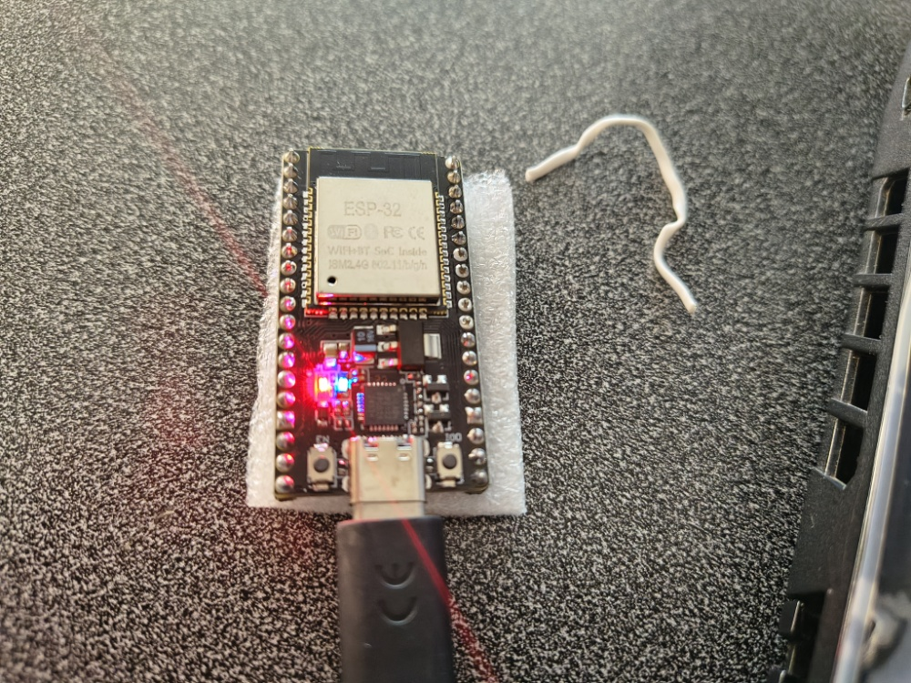
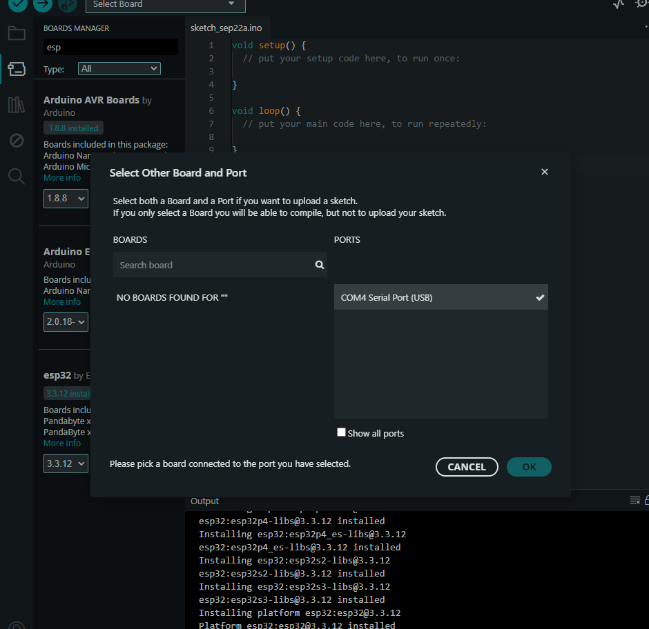
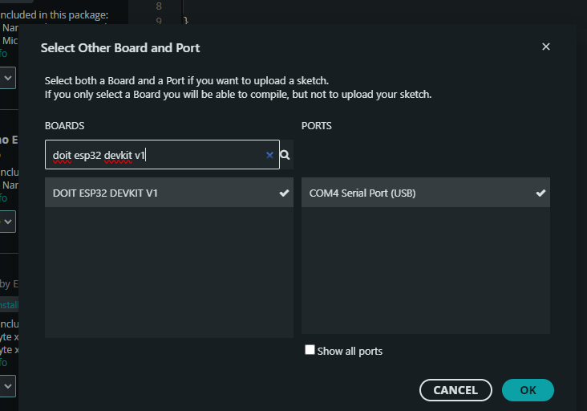
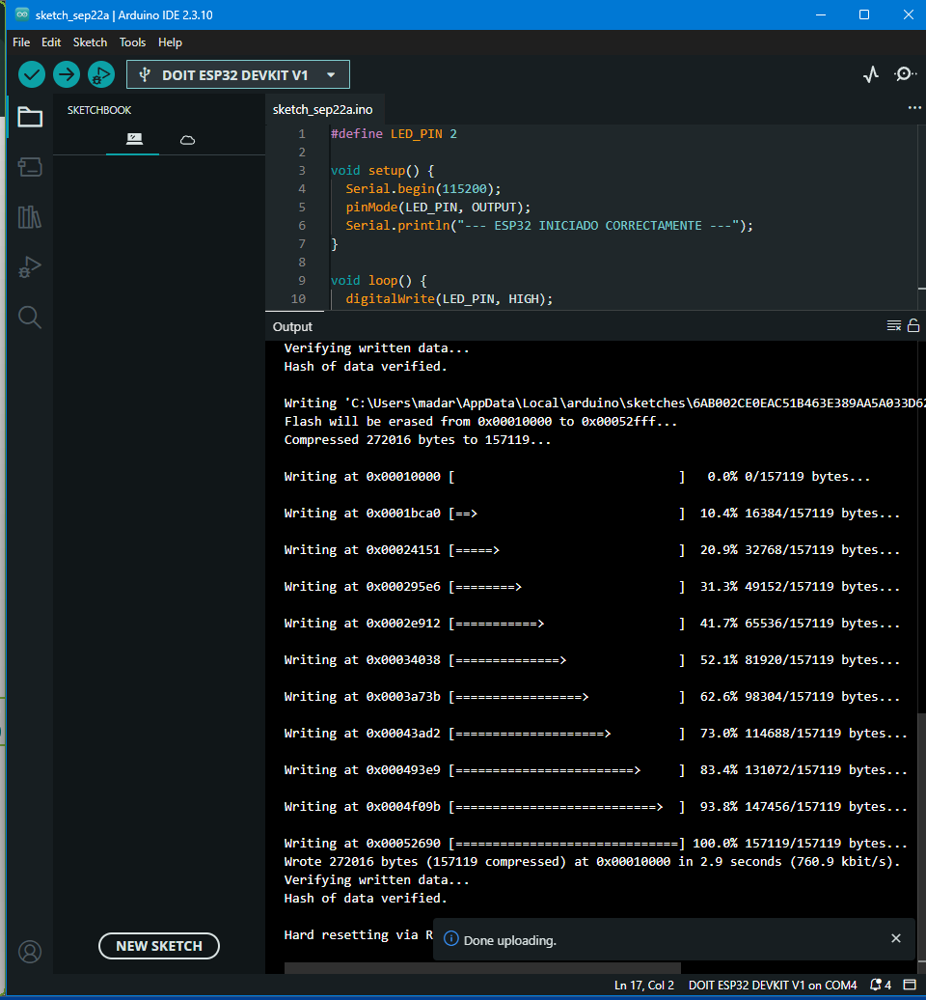
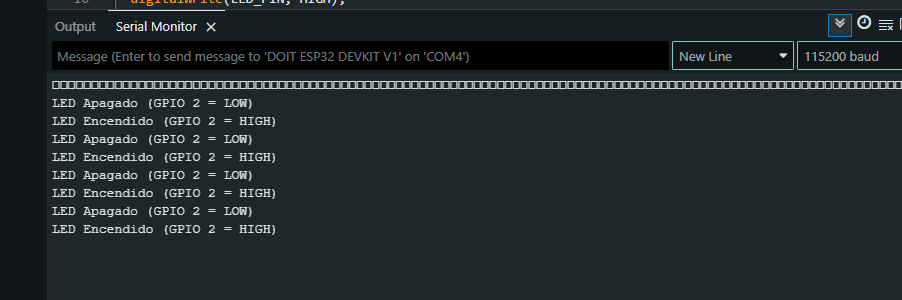
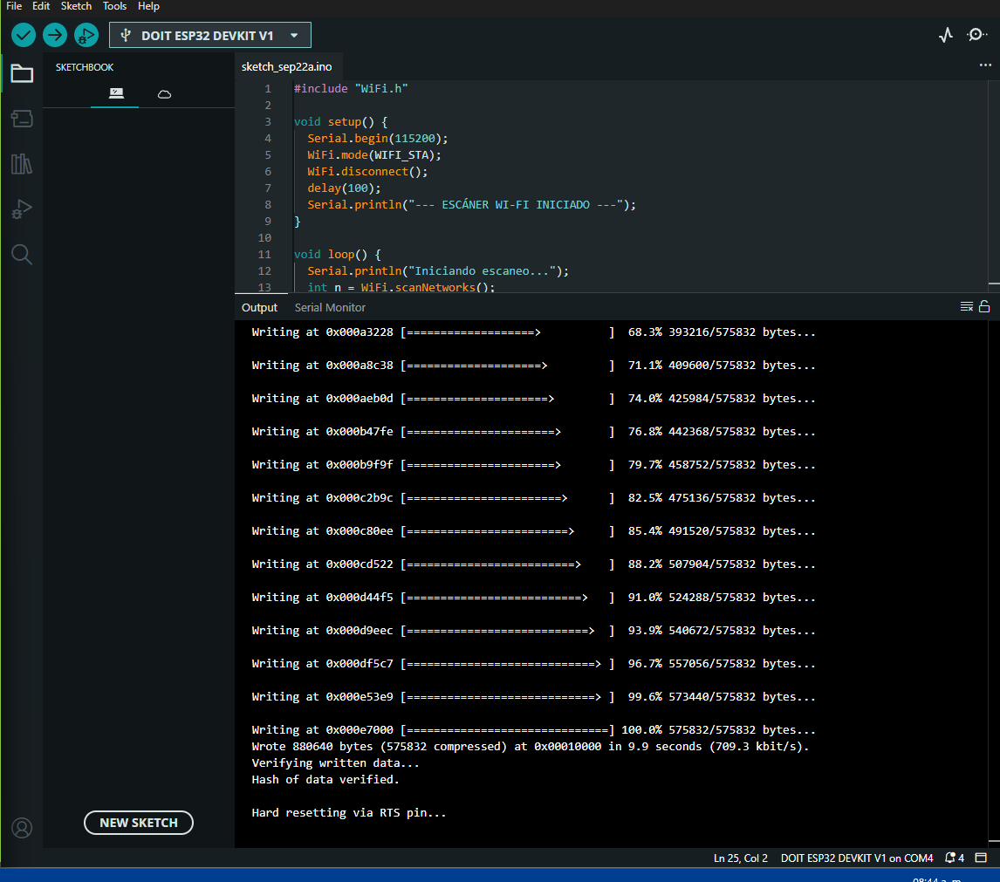

# Laboratorio N.° 02: Puesta en Marcha, Configuración del Toolchain y Validación del ESP32 NodeMCU

<div align="center">

**UNIVERSIDAD NACIONAL DE SAN ANTONIO ABAD DEL CUSCO**  
**Facultad de Ingeniería Eléctrica, Electrónica, Informática y Mecánica**  
**Escuela Profesional de Ingeniería Informática y de Sistemas**  

[-blue.svg)](https://www.espressif.com/)
[](https://www.arduino.cc/)
[](https://github.com/espressif/arduino-esp32)
[-orange.svg)](https://www.silabs.com/)

</div>

---

## 📌 Datos Informativos

* **Asignatura:** Robótica
* **Estudiante:** Noe Franklin Choquenaira Quispe
* **Código Universitario:** 133962 (1333962)
* **Docente:** Ing. Jose Mauro Pillco Quispe
* **Hardware:** ESP32 NodeMCU V1 (30 pines, interfaz USB Type-C)
* **Institución:** UNSAAC - Cusco, Perú

---

## 📖 Resumen Ejecutivo y Objetivos

Este laboratorio documenta la configuración metódica del entorno de desarrollo **Arduino IDE 2.3.10** para la placa de desarrollo **ESP32 NodeMCU V1 (30 pines)** basada en el SoC **ESP-WROOM-32**. Se cubren desde la integración del gestor de tarjetas oficial de Espressif hasta la resolución de conflictos de comunicación UART y la comprobación del transceptor de radiofrecuencia Wi-Fi.

### Objetivos Principales:
1. Instalar y configurar el toolchain oficial de Espressif (`esp32` v3.3.12).
2. Reconocer y configurar el puente USB-UART Silicon Labs CP2102 en el puerto COM asignado (`COM4`).
3. Superar incidencias de selección de perfiles de tarjeta (`DOIT ESP32 DEVKIT V1` vs `ESP32 Dev Module`).
4. Validar el control de GPIO mediante el LED de usuario integrado en `GPIO 2`.
5. Comprobar la estabilidad del reloj interno mediante telemetría UART continua a 115200 baudios.
6. Evaluar la integridad del transceptor Wi-Fi integrado (2.4 GHz) realizando barridos pasivos de canales 1 al 13.

---

## 🔬 Especificaciones de la Plataforma de Hardware

| Parámetro | Componente Físico | Función Técnica en el Sistema |
| :--- | :--- | :--- |
| **Microcontrolador** | ESP-WROOM-32 (Espressif Systems) | CPU Tensilica Xtensa Dual-Core 32-bit LX6 @ 240 MHz con Wi-Fi b/g/n y Bluetooth v4.2 BR/EDR/BLE |
| **Form Factor** | NodeMCU V1 (30 pines, USB Type-C) | Mapeo de entradas/salidas GPIO, buses I2C, SPI y alimentación regulada de 3.3V / 5.0V |
| **Puente USB-UART** | Silicon Labs CP2102 | Canal de flasheo y comunicación serial bidireccional asignado al puerto `COM4` |
| **Indicadores Ópticos** | LED Rojo (PWR) / LED Azul (GPIO 2) | Diagnóstico visual de alimentación y conmutación lógica digital del microcontrolador |

---

## 📂 Estructura de Archivos del Laboratorio

```text
labo_02/
├── README.md                                                        # Documentación completa del laboratorio
├── Informe de Laboratorio - Configuración y Pruebas ESP32 (1).pdf   # Informe técnico original en PDF
├── assets/
│   └── images/                                                      # Evidencias fotográficas del proceso
│       ├── esp32_inspeccion_fisica.jpeg
│       ├── gestor_tarjetas_esp32_instalado.png
│       ├── perfil_esp32_dev_module.png
│       ├── seleccion_doit_esp32_com4.png
│       ├── compilacion_exitosa.png
│       ├── flasheo_100_hard_reset.png
│       ├── monitor_serial_115200_led.png
│       ├── compilacion_wifi_scan.png
│       └── telemetria_continua_uart.png
└── firmware/
    ├── prueba1_blink_led/                                           # Prueba 1: Parpadeo de LED (GPIO 2)
    │   └── prueba1_blink_led.ino
    ├── prueba2_uart_ciclica/                                        # Prueba 2: Telemetría UART continua
    │   └── prueba2_uart_ciclica.ino
    └── prueba3_wifi_scan/                                           # Prueba 3: Barrido de canales Wi-Fi
        └── prueba3_wifi_scan.ino
```

---

## ⚙️ Configuración del Entorno en Arduino IDE

1. **URL de Gestor de Tarjetas Adicionales:**
   ```text
   https://espressif.github.io/arduino-esp32/package_esp32_index.json
   ```
2. **Paquete Instalado:** `esp32 by Espressif Systems` versión **3.3.12**.
3. **Placa Seleccionada:** `DOIT ESP32 DEVKIT V1` vinculada a `COM4`.
4. **Velocidad de Flasheo:** 921600 bps con frecuencia de CPU a 240 MHz.

---

## 🧪 Pruebas Experimentales Desarrolladas

### Prueba 1: Control de GPIO 2 (LED Azul Integrado)
Valida la conmutación digital y la sincronización con el monitor serial:
* **Archivo:** [`firmware/prueba1_blink_led/prueba1_blink_led.ino`](firmware/prueba1_blink_led/prueba1_blink_led.ino)
* **Salida serial:** Alterna periódicamente `LED Encendido` (1000 ms) y `LED Apagado` (1000 ms).

### Prueba 2: Telemetría UART Continua (1 Hz)
Verifica la estabilidad de la señal de reloj y la ausencia de desbordamiento de memoria o disparos del Watchdog Timer (WDT):
* **Archivo:** [`firmware/prueba2_uart_ciclica/prueba2_uart_ciclica.ino`](firmware/prueba2_uart_ciclica/prueba2_uart_ciclica.ino)
* **Salida serial:** Transmisión continua ininterrumpida de `ESP32 funcionando` a 115200 baudios.

### Prueba 3: Escaneo de Redes Wi-Fi (2.4 GHz)
Comprueba el transceptor de radiofrecuencia y la antena PCB integrada mediante la librería `WiFi.h`:
* **Archivo:** [`firmware/prueba3_wifi_scan/prueba3_wifi_scan.ino`](firmware/prueba3_wifi_scan/prueba3_wifi_scan.ino)
* **Operación:** Modo estación (`WIFI_STA`), escaneo pasivo de canales 1 al 13, imprimiendo SSID, RSSI (dBm) y canal.

---

## 🛠️ Resolución de Incidencias Técnicas

| Incidencia | Causa Raíz | Solución Aplicada |
| :--- | :--- | :--- |
| **Ambigüedad de tarjeta (30 pines)** | Distintos nombres comerciales para módulos ESP-WROOM-32. | Se homologó el uso de `DOIT ESP32 DEVKIT V1` o `ESP32 Dev Module`, con idéntica tabla de pines y configuración de memoria Flash (DIO / 80 MHz). |
| **Compilación vs Subida física** | Confusión entre botón verificar (✓) y subir (➜). | Se verificó la ejecución de `esptool.py` mediante la flecha de Upload para transferir el binario físico a la memoria Flash. |
| **Caracteres ilegibles en Serial Monitor** | Baudrate por defecto en 9600 bps mientras el firmware emitía a 115200 bps. | Cambio de la velocidad del Serial Monitor a **115200 baud**, sincronizando la recepción de datos. |

---

## 📷 Registro de Evidencias Fotográficas

| Inspección Física Inicial de la Placa | Gestor de Tarjetas Espressif Instalado |
| :---: | :---: |
|  |  |

| Selección de Placa DOIT ESP32 DEVKIT V1 | Flasheo al 100% y Hard Reset vía RTS |
| :---: | :---: |
|  |  |

| Recepción de Estados de LED en Serial Monitor | Telemetría Cíclica en Régimen Permanente |
| :---: | :---: |
|  |  |

---

## 🎯 Conclusiones del Laboratorio

1. La placa NodeMCU ESP32 (30 pines) respondió de forma totalmente transparente a los circuitos de auto-reset por pulsos RTS/DTR del convertidor CP2102, sin requerir pulsado manual del botón BOOT para la descarga de binarios.
2. Se verificó el funcionamiento integral de la memoria Flash, el reloj de 240 MHz, el puerto GPIO 2 y el transceptor Wi-Fi de 2.4 GHz.
3. El microcontrolador quedó formalmente homologado y listo para soportar aplicaciones de robótica móvil y sensado avanzado.
