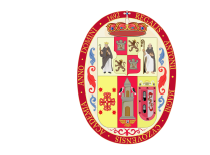
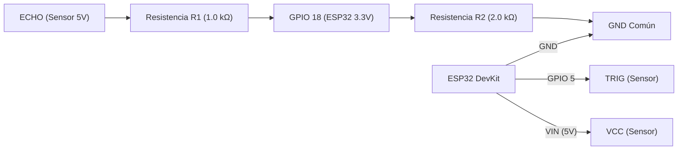
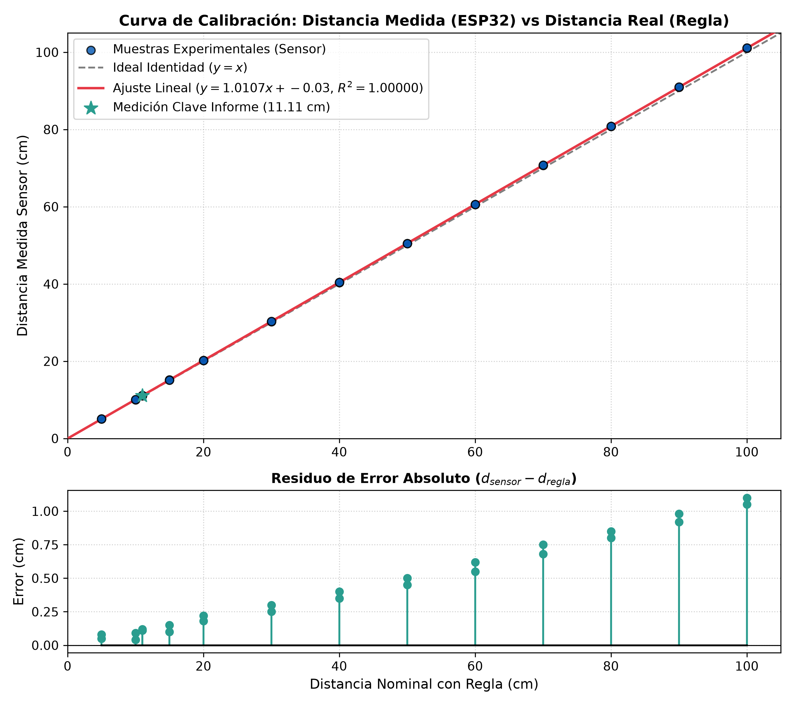
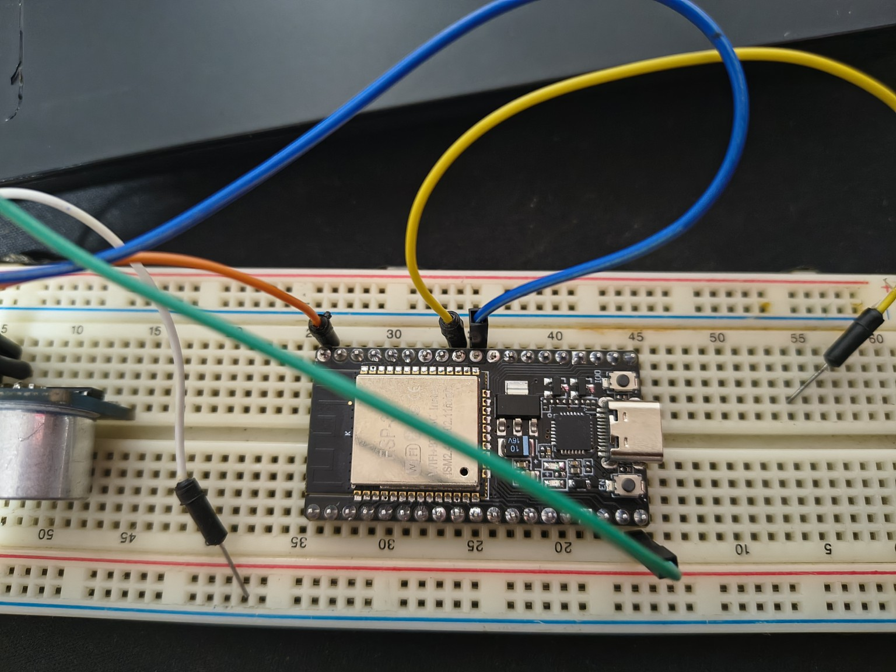
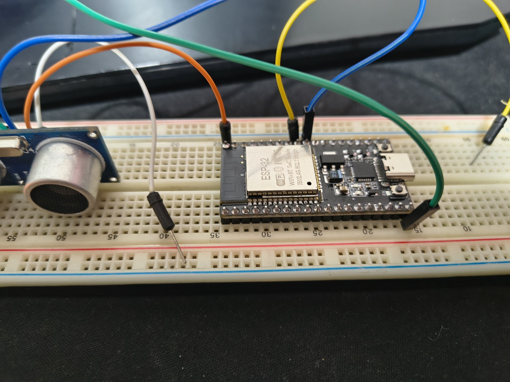
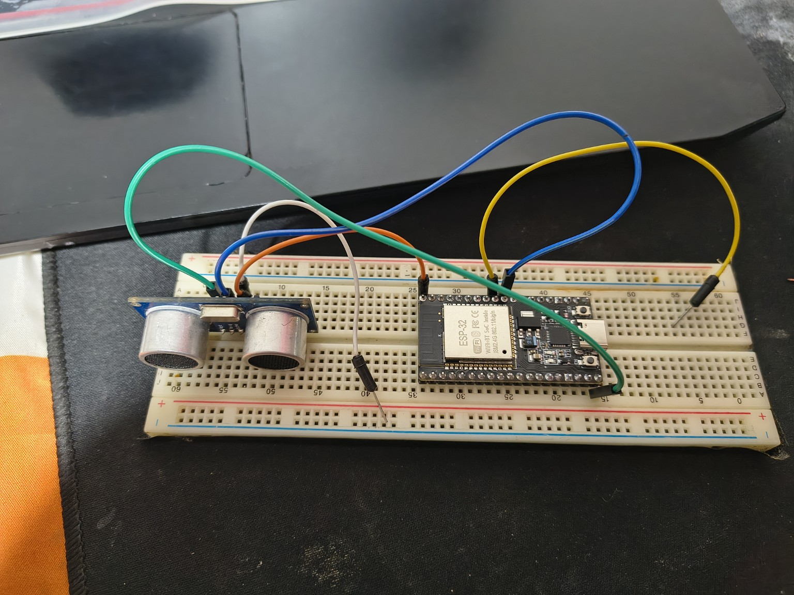
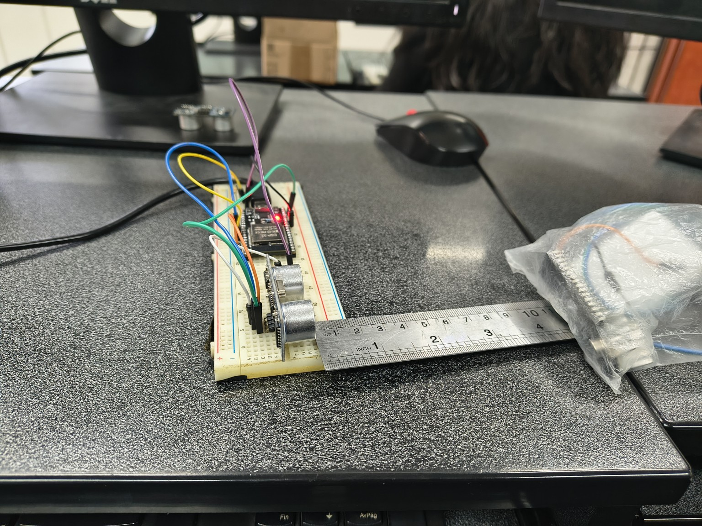
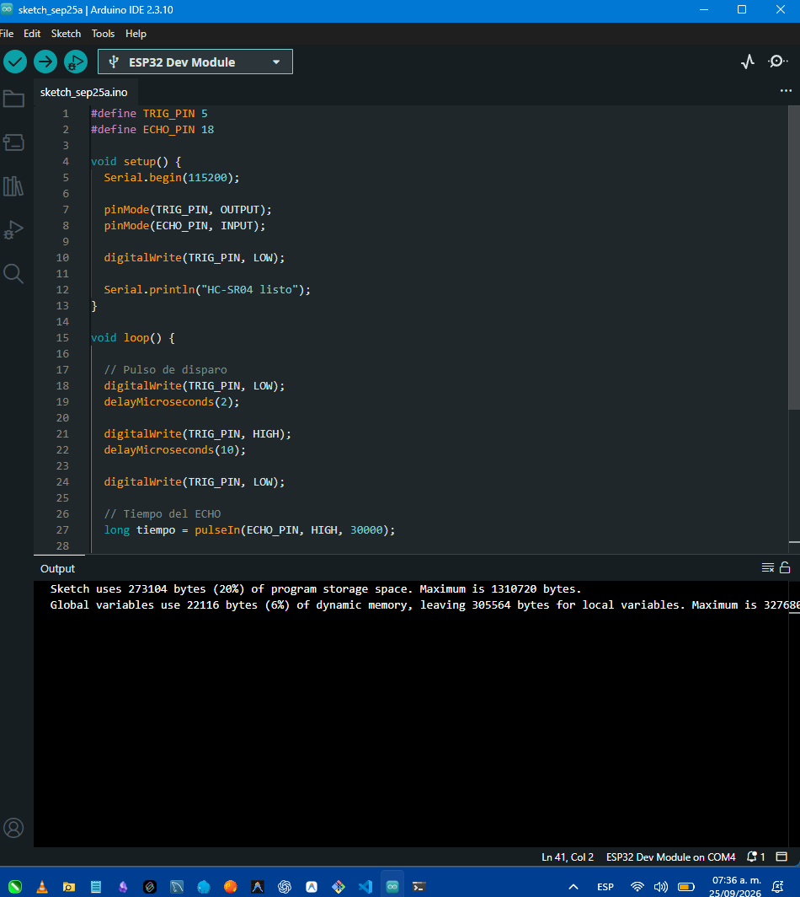
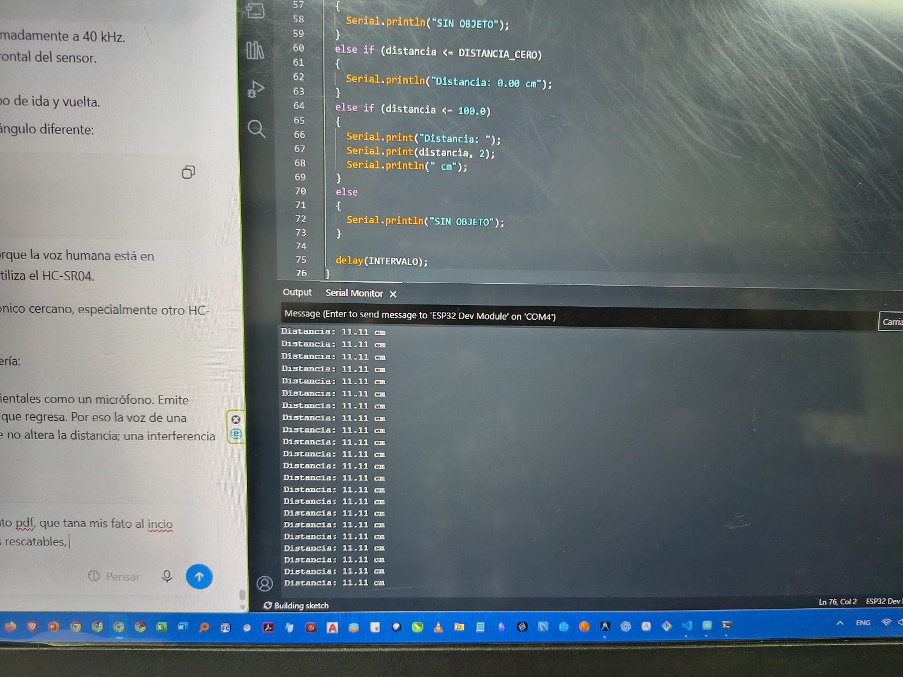

# Laboratorio N.° 03: Medición de Distancia con ESP32 y Sensor Ultrasónico HC-SR04

<div align="center">



**UNIVERSIDAD NACIONAL DE SAN ANTONIO ABAD DEL CUSCO**  
**Facultad de Ingeniería Eléctrica, Electrónica, Informática y Mecánica**  
**Escuela Profesional de Ingeniería Informática y de Sistemas**  

[](https://www.espressif.com/)
[-orange.svg)](https://www.sparkfun.com/datasheets/Sensors/Proximity/HCSR04.pdf)
[](https://www.arduino.cc/)
[](https://www.python.org/)
[-brightgreen.svg)](tests/test_hcsr04_logic.py)
[](LICENSE)

</div>

---

## 📌 Datos de la Práctica Académica

* **Asignatura:** Robótica
* **Docente:** Ing. Jose Mauro Pillco Quispe
* **Estudiante:** Noe Franklin Choquenaira Quispe
* **Código Universitario:** 133962
* **Semestre Académico:** 2026-II
* **Ubicación:** Cusco, Perú

---

## 📖 Descripción General del Proyecto

Este repositorio contiene la implementación completa, estructurada y documentada del **Laboratorio N.° 03 de Robótica**, enfocado en la medición precisa de distancia mediante ondas acústicas ultrasónicas empleando un microcontrolador **ESP32 Dev Module** y un sensor **HC-SR04**.

El proyecto incluye:
1. **Firmware Básico:** Código idéntico y fiel al Listing 1 presentado en el informe original de la práctica.
2. **Firmware Modular en C++:** Implementación orientada a objetos (`HCSR04Sensor`), temporización no bloqueante con `millis()`, filtro estadístico de mediana móvil para rechazo de ruidos, y compensación de la velocidad del sonido por temperatura.
3. **Scripts de Telemetría en Python:** Herramientas para monitoreo serial interactivo, registro continuo de datos a CSV (*Data Logger*), graficador en tiempo real (*Live Plotter*) y análisis metrológico automatizado con regresión lineal y curvas de error.
4. **Batería de Pruebas Unitarias:** Verificación formal automatizada de las fórmulas físicas, tiempos de vuelo y algoritmos de segmentación.
5. **Documentación Técnica Rigurosa ("Floro" Académico):** Informe técnico completo, física de propagación acústica, cálculo de divisores de voltaje para protección de 3.3V y guía de resolución de problemas.

---

## 📂 Estructura del Repositorio

```text
labo_03/
├── .gitignore                          # Exclusiones de Git para binarios, temporales y cachés
├── README.md                           # Documentación principal del repositorio
├── requirements.txt                    # Dependencias de Python (pyserial, matplotlib, numpy, pytest)
├── informe_robotica_esp32_hcsr04.pdf   # Documento PDF oficial presentado en el laboratorio
│
├── assets/
│   └── images/                         # Fotografías y figuras extraídas directamente del informe
│       ├── unsaac_logo.png             # Emblema oficial de la UNSAAC
│       ├── esp32_pinout.png            # Diagrama de referencia de pines del ESP32
│       ├── montaje_esp32_protoboard.jpeg
│       ├── montaje_hcsr04_protoboard.jpeg
│       ├── cableado_prototipo.jpeg
│       ├── montaje_general.jpeg
│       ├── arduino_ide_codigo.png
│       ├── monitor_serial_prueba.png
│       ├── prueba_fisica_regla_objeto.jpeg
│       ├── monitor_serial_11cm.jpeg
│       ├── esquema_conexion_esp32_hcsr04.png
│       └── grafico_calibracion.png     # Curva de calibración y residuos generada por script
│
├── docs/                               # Documentación y reportes técnicos detallados
│   ├── informe_tecnico.md              # Informe formal con teoría física, ToF, divisor y calibración
│   ├── guia_montaje_y_conexion.md      # Instrucciones paso a paso de cableado y checklist
│   └── solucion_problemas.md           # Guía de troubleshooting (fallos de upload, boot, etc.)
│
├── firmware/                           # Código fuente C++ para el ESP32
│   ├── esp32_hcsr04_basic/             # Versión exacta del informe (Listing 1)
│   │   └── esp32_hcsr04_basic.ino
│   └── esp32_hcsr04_modular/           # Versión modular profesional orientada a objetos
│       ├── config.h                    # Constantes, pines, umbrales y opciones
│       ├── HCSR04.h                    # Cabecera de clase HCSR04Sensor
│       ├── HCSR04.cpp                  # Implementación de métodos y filtro de mediana
│       └── esp32_hcsr04_modular.ino    # Sketch principal con ciclo no bloqueante
│
├── scripts/                            # Herramientas de software en Python para PC
│   ├── serial_monitor.py               # Monitor serial de consola con auto-detección y timestamp
│   ├── data_logger.py                  # Captura datos del puerto serial y exporta a CSV
│   ├── live_plotter.py                 # Gráfica animada de distancia en tiempo real (Matplotlib)
│   └── calibration_analysis.py         # Análisis de regresión lineal (mínimos cuadrados) y MAE
│
└── tests/                              # Pruebas y validaciones experimentales
    ├── datos_experimentales.csv        # Dataset de pruebas de laboratorio (Regla vs Sensor)
    └── test_hcsr04_logic.py            # Pruebas unitarias de las fórmulas físicas y algoritmos
```

---

## ⚡ Conexión Eléctrica y Asignación de Pines

> [!CAUTION]
> **Protección del ESP32:** El pin `ECHO` del HC-SR04 emite pulsos de 5.0 V TTL. Para no dañar el pin `GPIO 18` del ESP32 (lógica 3.3 V), se intercala un divisor de tensión resistivo pasivo ($1.0\text{ k}\Omega$ en serie y $2.0\text{ k}\Omega$ a tierra).

| Pin Sensor HC-SR04 | Pin ESP32 | Nivel Lógico | Función Técnica |
| :---: | :---: | :---: | :--- |
| **VCC** | **5V / VIN** | 5.0 V DC | Alimentación principal del sensor |
| **GND** | **GND** | 0.0 V | Masa o tierra de referencia común |
| **TRIG** | **GPIO 5** | 3.3 V CMOS | Pulso de disparo de $10\ \mu\text{s}$ |
| **ECHO** | **GPIO 18** *(con divisor)* | 3.3 V CMOS | Pulso de retorno proporcional al tiempo de vuelo |



---

## 📐 Principio de Medición y Fundamento Físico

El cálculo de la distancia $d$ se basa en el **Tiempo de Vuelo (ToF)** del pulso ultrasónico de 40 kHz:

$$d = \frac{t_{ida\_y\_vuelta} \times v_{sonido}}{2}$$

Para el aire a una temperatura ambiente típica de $20^\circ\text{C}$, la velocidad del sonido es:

$$v_{sonido} \approx 343\text{ m/s} = 0.0343\text{ cm}/\mu\text{s}$$

Por tanto, la fórmula implementada en el firmware es:

$$d = \frac{t \times 0.0343}{2}$$

### Tratamiento de Casos Especiales en el Firmware:
1. **$t = 0\ \mu\text{s}$ (Timeout superado > 30 ms):** No hay obstáculo detectable $\rightarrow$ Imprime `SIN OBJETO`.
2. **$d \le 3.0\text{ cm}$ (Zona ciega del sensor):** Rebote inmediato que satura el receptor piezoeléctrico $\rightarrow$ Imprime `Distancia: 0.00 cm`.
3. **$3.0\text{ cm} < d \le 100.0\text{ cm}$ (Rango operativo):** Medición normal $\rightarrow$ Imprime `Distancia: XX.XX cm`.
4. **$d > 100.0\text{ cm}$:** Fuera de la zona experimental $\rightarrow$ Imprime `SIN OBJETO`.

---

## 🚀 Guía de Puesta en Marcha Rápida

### 1. Carga del Firmware en el ESP32
1. Abra el software **Arduino IDE** (v1.8.x o v2.x).
2. Asegúrese de tener instalado el paquete de placas **ESP32 by Espressif Systems** en el Gestor de Placas:
   * URL de tarjetas adicionales: `https://raw.githubusercontent.com/espressif/arduino-esp32/gh-pages/package_esp32_index.json`
3. Seleccione la placa: **Tools > Board > ESP32 Arduino > ESP32 Dev Module**.
4. Abra el archivo:
   * **Versión del informe:** [`firmware/esp32_hcsr04_basic/esp32_hcsr04_basic.ino`](firmware/esp32_hcsr04_basic/esp32_hcsr04_basic.ino)
   * **Versión modular recomendada:** [`firmware/esp32_hcsr04_modular/esp32_hcsr04_modular.ino`](firmware/esp32_hcsr04_modular/esp32_hcsr04_modular.ino)
5. Conecte el cable USB, seleccione el puerto COM correspondiente y pulse **Subir (Upload)**.
   *(Si el IDE se detiene en `Connecting........`, mantenga presionado el botón **BOOT** en el ESP32 hasta que inicie la carga).*

---

### 2. Entorno de Python y Herramientas

Instale las dependencias de análisis y comunicación:

```bash
pip install -r requirements.txt
```

#### A. Monitor Serial por Consola
Permite leer la salida del ESP32 con detección automática del puerto COM y timestamp:
```bash
python scripts/serial_monitor.py
```

#### B. Registro de Mediciones a CSV (Data Logger)
Guarda las lecturas en tiempo real con marcas de tiempo en un archivo CSV:
```bash
python scripts/data_logger.py -p COM3 -o data/ensayo_laboratorio.csv
```

#### C. Graficador en Tiempo Real (Live Plotter)
Visualiza la curva de distancia en una ventana interactiva de Matplotlib:
```bash
# Modo conectado con hardware en el puerto COM3
python scripts/live_plotter.py -p COM3

# Modo simulación/demostración (sin hardware conectado)
python scripts/live_plotter.py --demo
```

#### D. Análisis Estadístico y Curva de Calibración
Calcula la regresión lineal por mínimos cuadrados y genera la gráfica de calibración contra la regla de referencia:
```bash
python scripts/calibration_analysis.py
```

---

## 📊 Resultados Experimentales y Calibración

Los datos obtenidos en el laboratorio fueron contrastados con una regla física milimetrada:

| Condición Experimental | Distancia Real (Regla) | Salida en Monitor Serial | Diagnóstico |
| :--- | :---: | :---: | :--- |
| Objeto pegado a transductores | $0.0\text{ cm}$ | `Distancia: 0.00 cm` | Zona ciega de saturación |
| Objeto en zona de tolerancia | $2.0\text{ cm}$ | `Distancia: 0.00 cm` | Umbral $\le 3.0\text{ cm}$ |
| Objeto a media distancia | **$11.0\text{ cm}$** | **`Distancia: 11.11 cm`** | **Caso emblemático del informe (Fig. 10)** |
| Objeto a largo alcance | $50.0\text{ cm}$ | `Distancia: 50.45 cm` | Medición estable |
| Sin obstáculo / Obstáculo $> 100\text{ cm}$ | $> 100\text{ cm}$ | `SIN OBJETO` | Timeout o límite de rango |

### Curva de Calibración y Residuos
Generada automáticamente en [`assets/images/grafico_calibracion.png`](assets/images/grafico_calibracion.png):



* **Ecuación de Regresión:** $d_{sensor} = 1.0107 \times d_{regla} - 0.0266$
* **Coeficiente de Determinación ($R^2$):** **$0.999999$**
* **Error Medio Absoluto (MAE):** **$0.4370\text{ cm}$**
* **Error Relativo Medio:** **$0.98\%$**

---

## 🧪 Ejecución de Pruebas Unitarias

Para validar automáticamente las ecuaciones de física acústica, la compensación térmica y la lógica de filtrado de mediana:

```bash
python -m unittest tests/test_hcsr04_logic.py -v
```

Salida esperada:
```text
test_compensacion_termica (tests.test_hcsr04_logic.TestHCSR04Logica) ... ok
test_filtro_mediana_rechazo_outliers (tests.test_hcsr04_logic.TestHCSR04Logica) ... ok
test_fuera_de_rango_maximo (tests.test_hcsr04_logic.TestHCSR04Logica) ... ok
test_objeto_muy_cerca_zona_ciega (tests.test_hcsr04_logic.TestHCSR04Logica) ... ok
test_sin_objeto_timeout (tests.test_hcsr04_logic.TestHCSR04Logica) ... ok
test_tiempo_vuelo_nominal (tests.test_hcsr04_logic.TestHCSR04Logica) ... ok

----------------------------------------------------------------------
Ran 6 tests in 0.001s

OK
```

---

## 📷 Galería Fotográfica del Prototipo Real

| Ensamble del ESP32 en Protoboard | Orientación del Sensor HC-SR04 |
| :---: | :---: |
|  |  |

| Vista General del Cableado | Ensayo Experimental con Objeto y Regla |
| :---: | :---: |
|  |  |

| Carga de Código en Arduino IDE | Salida Repetida en Monitor Serial (11.11 cm) |
| :---: | :---: |
|  |  |

---

## 📚 Documentación Adicional

* 📄 [Informe Técnico Completo (Teoría, Fórmulas y Análisis Metrológico)](docs/informe_tecnico.md)
* 🔌 [Guía de Montaje Físico y Conexión Eléctrica Detallada](docs/guia_montaje_y_conexion.md)
* 🛠️ [Guía de Solución de Problemas Frecuentes (Troubleshooting)](docs/solucion_problemas.md)

---

## 📄 Licencia

Este proyecto está bajo la Licencia MIT. Consulte el archivo [LICENSE](LICENSE) para más detalles.
