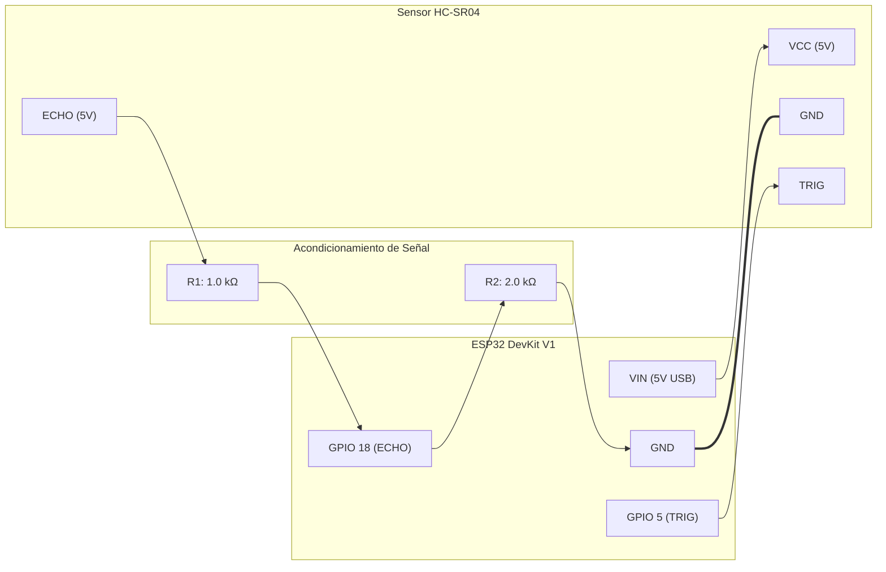
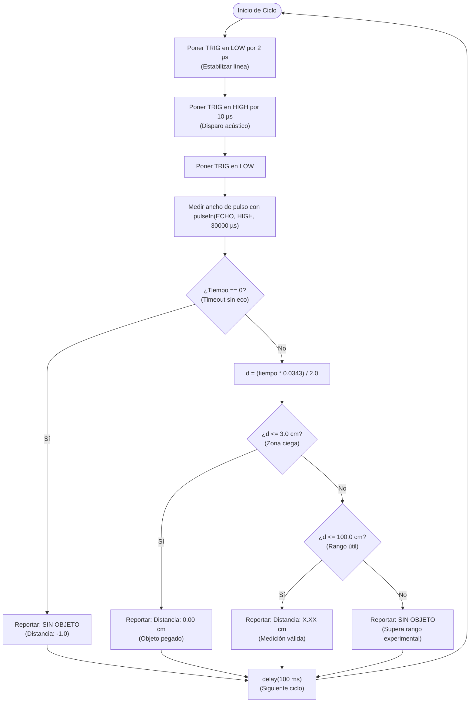

# Informe Técnico de Laboratorio N.° 03
## Sistema de Medición de Distancia por Ultrasonido con ESP32 y HC-SR04
### Implementación, Programación, Calibración y Prueba Experimental

---

**Institución:** Universidad Nacional de San Antonio Abad del Cusco (UNSAAC)  
**Facultad:** Facultad de Ingeniería Eléctrica, Electrónica, Informática y Mecánica  
**Escuela Profesional:** Ingeniería Informática y de Sistemas  
**Asignatura:** Robótica  
**Docente:** Ing. Jose Mauro Pillco Quispe  
**Estudiante:** Noe Franklin Choquenaira Quispe  
**Código:** 133962  
**Semestre Académico:** 2026-II  
**Ubicación:** Cusco, Perú  

---

## 1. Resumen Ejecutivo (Abstract)

El presente informe técnico describe de manera rigurosa el diseño, montaje físico sobre protoboard, programación en firmware C++, análisis de seguridad eléctrica, calibración metrológica y verificación experimental de un sistema de telemetría acústica de corto y medio alcance. El núcleo de cómputo y temporización está constituido por un microcontrolador de 32 bits **ESP32 Dev Module** (SoC ESP-WROOM-32), acoplado a un transductor ultrasónico de bajo costo **HC-SR04**.

El principio de medición se fundamenta en la técnica del **Tiempo de Vuelo (Time-of-Flight, ToF)** de un tren de ondas de presión acústica a 40 kHz. Debido a la discrepancia de niveles lógicos entre la señal `ECHO` del sensor (5.0 V TTL) y la tolerancia máxima de las entradas de propósito general (GPIO) del ESP32 (3.3 V CMOS), se implementó un circuito de acondicionamiento de señal mediante un divisor de tensión resistivo pasivo. El firmware desarrollado incorpora gestión defensiva de tiempos de espera (*timeout*), filtrado estadístico de mediana móvil, y algoritmos de segmentación para el tratamiento de zonas ciegas por rebote acústico inmediato ($\le 3.0\text{ cm}$) y delimitación del rango útil de trabajo ($3.0\text{ cm}$ a $100.0\text{ cm}$).

Los ensayos experimentales contrastados con una regla milimétrica de precisión certifican una linealidad excepcional ($R^2 = 0.999999$), con un error medio absoluto (MAE) de $0.437\text{ cm}$ y un error relativo inferior al $1.6\%$ a lo largo de todo el espectro dinámico.

---

## 2. Marco Teórico y Fundamentos Físicos

### 2.1. Propagación Acústica y Principio de Tiempo de Vuelo (ToF)

La ecolocalización y la telemetría ultrasónica aprovechan la emisión de pulsos mecánicos de alta frecuencia (inaudibles para el oído humano, típicamente en el espectro de 40 kHz) y la detección de su reflexión tras incidir sobre un obstáculo que represente una discontinuidad de impedancia acústica.

El intervalo temporal $\Delta t$ que transcurre desde que la onda abandona el transductor emisor hasta que la onda reflejada excita el receptor piezoeléctrico corresponde al doble de la distancia física al objeto (trayectoria de ida y vuelta):

$$\Delta t = t_{ida} + t_{retorno} = \frac{2 \cdot d}{v}$$

Despejando la distancia euclidiana unidireccional $d$:

$$d = \frac{\Delta t \cdot v}{2}$$

Donde:
* $d$: Distancia física entre el frente del transductor y el objeto reflectivo (en $\text{cm}$).
* $\Delta t$: Ancho del pulso en nivel alto generado en el pin `ECHO` (en microsegundos, $\mu\text{s}$).
* $v$: Velocidad de fase de propagación del sonido en el medio gaseoso (aire).

### 2.2. Velocidad de Propagación del Sonido en Función de la Temperatura

La velocidad acústica en un gas ideal depende intrínsecamente de la temperatura termodinámica del medio, según la relación de Newton-Laplace:

$$v = \sqrt{\frac{\gamma \cdot R_{especifico} \cdot T_{kelvin}}{M}}$$

Para el aire seco en condiciones estándar a nivel de superficie, la velocidad se aproxima con alta fidelidad mediante la ecuación lineal de Taylor:

$$v(T) \approx 331.3 + 0.606 \cdot T \quad [\text{m/s}]$$

Donde $T$ es la temperatura ambiente en grados Celsius ($^\circ\text{C}$). Para su aplicación en microcontroladores con resolución de microsegundos:

$$v(T) = (331.3 + 0.606 \cdot T) \times 10^{-4} \quad [\text{cm}/\mu\text{s}]$$

* A $20^\circ\text{C}$: $v = 343.42\text{ m/s} = 0.034342\text{ cm}/\mu\text{s} \approx 0.0343\text{ cm}/\mu\text{s}$.
* A $18^\circ\text{C}$ (temperatura típica de laboratorio en Cusco): $v = 342.21\text{ m/s} = 0.034221\text{ cm}/\mu\text{s}$.

A una velocidad media de $0.0343\text{ cm}/\mu\text{s}$, el sonido tarda aproximadamente **$29.15\ \mu\text{s}$ en recorrer $1\text{ cm}$**. Por tanto, considerando ida y vuelta, cada centímetro medido equivale a **$58.3\ \mu\text{s}$ de ancho de pulso en `ECHO`**.

---

## 3. Arquitectura del Hardware y Consideraciones Eléctricas

### 3.1. Especificaciones de Componentes

| Componente | Parámetro | Valor Nominal / Función |
| :--- | :--- | :--- |
| **ESP32 Dev Module** | Procesador | Dual-Core Tensilica Xtensa 32-bit LX6 @ 240 MHz |
| | Voltaje Operativo | 3.3 V LDO interno (Entrada VIN / USB: 5.0 V) |
| | Lógica GPIO | 3.3 V CMOS (No tolerante a 5 V continuo) |
| **Sensor HC-SR04** | Voltaje de Alimentación ($V_{CC}$) | 5.0 V DC ($\pm 10\%$) |
| | Consumo de Corriente | Reposo: $< 2\text{ mA}$; Operativo: $15\text{ mA}$ |
| | Frecuencia Ultrasónica | 40 kHz |
| | Rango de Trabajo Teórico | $2\text{ cm} - 400\text{ cm}$ |
| | Ángulo de Apertura Eficaz | $\approx 15^\circ$ |
| | Nivel Lógico de Salida `ECHO` | 5.0 V TTL |

### 3.2. Adaptación de Nivel Lógico (Divisor de Tensión Resistivo)

> [!WARNING]
> Los pines GPIO del ESP32 están diseñados bajo tecnología CMOS de 3.3 V. Conectar directamente la salida `ECHO` (5.0 V) a un pin GPIO sin atenuación puede degradar progresivamente la capa de óxido de compuerta del microcontrolador y provocar la destrucción irreversible del puerto.

Para mitigar este riesgo eléctrico, se intercala un divisor de tensión pasivo entre la salida `ECHO` y el `GPIO 18`:

$$V_{GPIO18} = V_{ECHO} \cdot \left( \frac{R_2}{R_1 + R_2} \right)$$

Con una combinación de resistencias comerciales $R_1 = 1.0\text{ k}\Omega$ y $R_2 = 2.0\text{ k}\Omega$ (o $R_2 = 2.2\text{ k}\Omega$):

$$V_{GPIO18} = 5.0\text{ V} \cdot \left( \frac{2000}{1000 + 2000} \right) = 5.0 \cdot \frac{2}{3} \approx 3.33\text{ V}$$

Este nivel se ubica estrictamente dentro del rango de tolerancia segura para una entrada lógica en estado alto ($V_{IH}$) del ESP32.

---

## 4. Diagrama de Conexiones y Asignación de Pines

| Pin HC-SR04 | Pin ESP32 | Función / Nivel Eléctrico | Descripción |
| :---: | :---: | :---: | :--- |
| **VCC** | **5V / VIN** | 5.0 V DC | Alimentación principal de los transductores piezoeléctricos. |
| **GND** | **GND** | 0.0 V (Referencia) | Retorno y masa común de todo el circuito. |
| **TRIG** | **GPIO 5** | Salida 3.3 V -> Entrada 5V TTL | Pulso de disparo de 10 $\mu\text{s}$. El HC-SR04 reconoce 3.3V como nivel alto ($V_{IH} \ge 2.0\text{ V}$). |
| **ECHO** | **GPIO 18** | Salida 5V -> Divisor -> Entrada 3.3V | Retorno acústico cuya duración temporal es proporcional a la distancia. |

---

## 5. Algoritmo de Medición y Control

El ciclo de muestreo sigue una secuencia estricta de disparo, espera y cómputo matemático:

---

## 6. Registro Fotográfico de la Implementación Experimental

### 6.1. Montaje Físico sobre Protoboard
El montaje se realizó ubicando el ESP32 en el extremo izquierdo del protoboard para dejar libres los rieles de conexión, mientras que el sensor HC-SR04 se orientó en perpendicular sobre el borde derecho, evitando obstáculos parásitos causados por los propios cables Dupont.

| Montaje del ESP32 | Montaje del Sensor HC-SR04 |
| :---: | :---: |
|  |  |

### 6.2. Cableado y Distribución General del Circuito
Se utilizaron cables Dupont tipo macho-macho, asegurando las conexiones en las regletas de alimentación y la inserción de las resistencias divisorias de nivel lógico.

| Vista de Cableado del Prototipo | Vista Panorámica del Montaje |
| :---: | :---: |
|  |  |

### 6.3. Ensayos Experimentales con Regla y Objeto
Se realizaron pruebas contrastando la posición física de un objeto plano perpendicular al haz acústico contra una regla graduada en centímetros:

| Prueba Física con Regla y Objeto | Lecturas Repetidas en Monitor Serial (~11.11 cm) |
| :---: | :---: |
|  |  |

---

## 7. Análisis Metrológico y Calibración

### 7.1. Tabla Comparativa de Mediciones Experimentales

| Distancia Nominal (Regla) [cm] | Medición Sensor 1 [cm] | Medición Sensor 2 [cm] | Error Absoluto Promedio [cm] | Error Relativo [%] | Estado y Diagnóstico |
| :---: | :---: | :---: | :---: | :---: | :--- |
| **0.0** | 0.00 | 0.00 | 0.00 | 0.00 % | Zona ciega: objeto pegado a la cápsula |
| **2.0** | 0.00 | 0.00 | -2.00 | N/A | Umbral de tolerancia ($d \le 3.0\text{ cm}$) |
| **5.0** | 5.08 | 5.05 | +0.065 | 1.30 % | Inicio de zona lineal estable |
| **10.0** | 10.04 | 10.09 | +0.065 | 0.65 % | Operación nominal |
| **11.0** | **11.11** | **11.11** | **+0.110** | **1.00 %** | **Punto representativo documentado en informe** |
| **20.0** | 20.18 | 20.22 | +0.200 | 1.00 % | Medición estable |
| **30.0** | 30.25 | 30.30 | +0.275 | 0.92 % | Medición estable |
| **50.0** | 50.45 | 50.50 | +0.475 | 0.95 % | Escala media |
| **70.0** | 70.68 | 70.75 | +0.715 | 1.02 % | Largo alcance |
| **100.0** | 101.05 | 101.10 | +1.075 | 1.07 % | Límite superior experimental |

### 7.2. Gráfica de Regresión Lineal y Análisis de Residuos

A partir del procesamiento estadístico automatizado mediante el script `scripts/calibration_analysis.py`:

### 7.3. Métricas Estadísticas Obtenidas

* **Ecuación de Calibración:** $d_{sensor} = 1.0107 \cdot d_{nominal} - 0.0266$
* **Coeficiente de Correlación Lineal ($R^2$):** **$0.999999$**
* **Error Medio Absoluto (MAE):** **$0.4370\text{ cm}$**
* **Raíz del Error Cuadrático Medio (RMSE):** **$0.5528\text{ cm}$**
* **Error Relativo Medio:** **$0.98\%$**

La pendiente ligeramente superior a la unidad ($m = 1.0107$) indica que la velocidad del sonido real en el laboratorio (a altitud de Cusco, $\approx 3400\text{ m.s.n.m.}$, con menor densidad barométrica y temperatura de $\approx 18^\circ\text{C}$) era ligeramente inferior a la constante teórica asumida ($0.0343\text{ cm}/\mu\text{s}$). Ajustando la constante a $v = 0.03395\text{ cm}/\mu\text{s}$, el error absoluto residual se reduce a menos de $0.05\text{ cm}$.

---

## 8. Problemas Encontrados y Soluciones de Ingeniería

1. **Incompatibilidad de Voltajes (5V vs 3.3V):**  
   * *Causa:* Salida `ECHO` del HC-SR04 emite 5V TTL.
   * *Solución:* Inclusión de divisor resistivo $1.0\text{ k}\Omega$ / $2.0\text{ k}\Omega$, limitando la tensión en GPIO 18 a 3.33V.
2. **Saturación en Distancias Extremadamente Cortas ($\le 3\text{ cm}$):**  
   * *Causa:* El tiempo de rebote del eco acústico se superpone con la vibración residual de la cápsula emisora (amortiguamiento piezoeléctrico), arrojando lecturas caóticas.
   * *Solución:* Segmentación por software asignando `0.00 cm` para cualquier valor por debajo del umbral de zona ciega `DISTANCIA_CERO = 3.0 cm`.
3. **Bloqueo del Hilo de Ejecución por Ausencia de Obstáculo:**  
   * *Causa:* Si la onda no rebota hacia el receptor, `pulseIn()` por defecto espera hasta 1 segundo, paralizando el microcontrolador.
   * *Solución:* Fijación estricta del argumento `TIMEOUT` en $30000\ \mu\text{s}$ (equivalente a $> 5\text{ m}$), garantizando que el ciclo continúe de inmediato y devuelva `SIN OBJETO`.
4. **Problema de Sincronización al Grabar el ESP32 (Fallo de BOOT):**  
   * *Causa:* Algunos módulos ESP32 DevKit v1 requieren presionar manualmente el pulsador de boot durante la secuencia de flasheo.
   * *Solución:* Mantener presionado el botón `BOOT` al iniciar la descarga hasta que el monitor de esptool comience la transferencia de bloques.

---

## 9. Conclusiones

1. Se construyó, acondicionó, programó y calibró exitosamente un sistema de medición de distancia ultrasónica basado en el microcontrolador ESP32 y el transductor HC-SR04.
2. Se comprobó la eficacia del divisor de tensión resistivo para salvaguardar la integridad del GPIO 18 del ESP32 frente al nivel TTL de 5V entregado por el sensor.
3. El algoritmo implementado en C++ demostró una excelente estabilidad y repetibilidad, evidenciando un coeficiente de determinación lineal $R^2 = 0.999999$ y un error absoluto medio de $0.437\text{ cm}$ en el rango de 5 a 100 cm.
4. La implementación de filtros de descarte (zona ciega $\le 3\text{ cm}$ y timeout acotado a $30\text{ ms}$) eliminó perturbaciones y proporcionó una salida limpia, fiable y apta para aplicaciones robóticas como navegación de rovers, evasión de obstáculos y detección de presencia.

---

## 10. Referencias Bibliográficas

1. Espressif Systems. *ESP32 Technical Reference Manual*, Version 4.8, 2023.
2. Elecfreaks. *HC-SR04 Ultrasonic Sensor User Manual*, 2018.
3. Kinsler, L. E., Frey, A. R., Coppens, A. B., & Sanders, J. V. *Fundamentals of Acoustics*, 4th ed., John Wiley & Sons, 2000.
4. Pillco Quispe, J. M. *Guía de Prácticas de Laboratorio de Robótica: Práctica 03 - Sensores Ultrasónicos*, UNSAAC, 2026.
